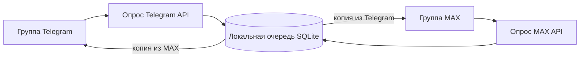

# Как работает текущий мост Telegram ↔ MAX

Согласованное описание сервиса приведено в [README](../../README.md). Ниже описана текущая техническая реализация.

Асинхронное выполнение внедрено: отдельные получатели и отправители работают через `asyncio/aiohttp`, heartbeat не ждёт сетевых ответов. Схема 3 и правила очереди сохраняются. Живые проверки проводились 20.10.2026 и 29.10.2026; расширенная приёмка выполнена частично. После прогона 29.10.2026 тестовый мост остановлен по просьбе владельца.

Для текущей одной пары групп приняты и слиты в `main`: [D1 — Docker-поставка](SERVER-DEPLOYMENT-PLAN.md#приёмка-d1), [D2 — ошибки API/сети и безопасные повторы](SERVER-DEPLOYMENT-PLAN.md#приёмка-d2), [D3 — сохранность и восстановление](SERVER-DEPLOYMENT-PLAN.md#приёмка-d3), [D4 — healthcheck, структурированные логи и диагностика](SERVER-DEPLOYMENT-PLAN.md#приёмка-d4). Ниже описаны принятый D4 и реализации D5.1/D5.2 в отдельных ветках; результаты и границы хранятся в плане. [D5.1 — контроль хранилища](SERVER-DEPLOYMENT-PLAN.md#d51-контроль-хранилища) подготовлен к приёмке; D5.2 реализует очистку SQLite и ожидает проверки, полный D5 ещё не принят.

Текущая тестовая версия работает с **двумя заранее выбранными тестовыми группами**, локально либо в Docker. Участники пишут в привычном мессенджере. Бот читает новые сообщения своей группы и публикует копии в другой группе **от имени бота**, добавляя имя исходного автора и название площадки.

Двусторонний обмен между группами уже реализован. **Поддержка каналов и нескольких связок запланирована, но ещё не реализована:** Telegram-получатель запрашивает только `message`, обработчик извлекает `event.message`, а `doctor` отклоняет типы чатов, отличные от групповых. Канальные публикации Telegram требуют обработки `channel_post`. Простая замена ID группы на ID канала в `.env` не подключает канал.

Актуализация 20.10.2026: изменения надёжности и async-код внедрены в живое тестовое окружение, пользователь подтвердил работу; дополнительный тест дал 44 доставки. Схема базы — 3; локальный монитор запущен отдельно. Серверного размещения и внешней доставки оповещений пока нет; условия подготовки сервера заказчика описаны в [требованиях к серверу](OPERATIONS.md#требования-к-серверу).

Например, если Анна пишет в Telegram «Когда занятие?», в MAX появляется сообщение от бота:

> Анна · Telegram  
> Когда занятие?

Связь двусторонняя: тот же путь работает из MAX в Telegram. Бот не выдаёт себя за автора; имя участника указано в тексте копии. В первой версии переносятся новые обычные тексты, картинки и подписи к ним. [Исходный код](bridge.py).

## Путь сообщения



1. Программа опрашивает Telegram через `getUpdates`, MAX через `/updates`. В обоих случаях используется получение новых событий по указателю: `update_id` или `marker`. Вебхуки в текущем тесте не используются. Получатели выполняются независимо: каждый делает один запрос за раз и ждёт около секунды после успеха. При сетевой ошибке задержка растёт от 2 до 30 секунд; `retry_after` может увеличить её. Один медленный запрос не задерживает независимые операции другой платформы.
2. Она принимает только новые сообщения из ID двух групп, записанных в `.env`. События из личных чатов и других групп игнорируются. Свои сообщения каждый бот распознаёт по ID и не отправляет обратно — это основная защита от цикла.
3. Из события берутся текст, имя автора, картинка, подпись и сведения об ответе на другое сообщение. Вложения вне объёма теста отмечаются текстом «Вложение вне объёма теста не перенесено».
4. Сообщение разбивается на части, если оно не помещается в ограничения отправки. Каждая часть становится задачей в локальной очереди. Программа отправляет задачи по порядку отдельно для каждого направления и сохраняет ID опубликованной копии.

Сообщение и указатель входящих событий записываются в SQLite **одной транзакцией**. Поэтому после перезапуска ранее принятое событие не должно исчезнуть между подтверждением чтения и записью задачи. Дополнительно таблица `inbox` хранит сочетание «площадка + чат + ID сообщения»: повторно полученное событие не создаёт новую задачу.

## Текст, картинки и ответы

Некорректное содержимое события выбранной группы теперь попадает в отдельный карантин с причиной. Остальные сообщения пакета обрабатываются; карантин и курсор сохраняются в той же транзакции. Открытые проблемы видны через `status`. Чужие чаты не архивируются. При неизвестном чате, ошибке базы или неожиданной ошибке программы пакет не подтверждается. Восстановленное позднее событие может попасть после более новых сообщений.

Для картинки программа скачивает файл, проверяет предел **10 МиБ** и распознаёт JPEG, PNG или WEBP по содержимому. Telegram иногда отдаёт фотографию с общим MIME-типом `application/octet-stream`, поэтому одного заголовка недостаточно. Картинка загружается на целевую площадку заново: локальные ID файлов Telegram и MAX между собой не подходят. Первая картинка получает подпись; дополнительные картинки одного сообщения могут стать отдельными сообщениями. Оформление альбома не сохраняется.

Если участник отвечает на сообщение, программа ищет сохранённое соответствие ID исходного сообщения и его копии. Когда соответствие найдено, отправляет **настоящий ответ** средствами целевой площадки. Если связь недоступна, короткая цитата исходного текста остаётся в теле копии. Живой тест 19.10.2026 подтвердил ответы в обе стороны.

Форматирование исходного сообщения не переносится как HTML или Markdown. Текст автора отправляется как обычный текст. Для длинных сообщений применяется разбиение с учётом ограничения Telegram на символы Unicode; картинки и длинная подпись также могут оказаться в нескольких сообщениях.

## Очередь и сбои

Очередь хранится в `.state/bridge.sqlite3` при локальном запуске, в Docker — в `/state/bridge.sqlite3` на постоянном volume; она переживает остановку программы. Основные состояния задачи:

| Состояние | Значение |
|---|---|
| `pending` | Ожидает отправки или безопасного повтора |
| `sending` | Запрос публикации начался, результат ещё не записан |
| `sent` | API вернул успешный результат, ID копии сохранён |
| `failed` | Обнаружена определённая ошибка; нужна проверка |
| `uncertain` | Неизвестно, успела ли площадка опубликовать сообщение; нужна ручная проверка |
| `skipped` | Оператор явно пропустил задачу с записью причины; доставка следующих задач разрешена |

Для восстановления используются команды `queue retry/confirm/skip` и `quarantine retry`; перед изменением очереди мост нужно остановить. Просмотр доступен во время работы и не выводит содержимое сообщений. Все ручные изменения фиксируются в `audit`. Порядок действий — в [инструкции оператора](OPERATIONS.md).

Ограничение частоты в коде: между отправками в Telegram не менее **3,2 с**, в MAX — **0,6 с**. Ошибки разделяются по фазе запроса:

- **Безопасный повтор, задача остаётся `pending`.** Сюда относятся `429`, `attachment.not.ready`, временный сбой скачивания или подготовки фото (сеть, HTTP 429 или 5xx) и отказ соединения до отправки запроса: соединение не установлено, таймаут подключения, DNS. Повтор назначается с экспоненциальной задержкой 2, 4, 8 … 120 с с разбросом +0–20 %. Если сервер указал более поздний срок через Telegram `retry_after` или HTTP `Retry-After` (секунды или HTTP-date), повтор не начнётся раньше него; учитывается максимальное из указаний, собственный предел backoff его не сокращает. Непредставимые значения (больше 10^300 с, очень длинные числа) и некорректные указания игнорируются: действует обычная задержка.
  - Срок хранится в `jobs.ready` и сохраняется при пересоздании контейнера.
  - Задержка растёт с каждой попыткой этой задачи; следующая задача начинает с 2 с.
  - Загруженное вложение MAX после `attachment.not.ready` или `429` используется повторно до 10 минут, без новой загрузки.
- **Постоянная ошибка, задача становится `failed`.** Это 401/403, другие отклонения 4xx (в том числе при скачивании фото, например 404), ошибка проверки TLS-сертификата и неподдерживаемое фото. Такая задача ждёт оператора, без частых повторов.
- **Публикация могла состояться, задача становится `uncertain`.** Это обрыв связи, таймаут чтения, HTTP 5xx (даже если в теле указан код `429` или `attachment.not.ready`) или некорректный ответ после начала публикации: автоматический повтор мог бы создать дубль. В этом случае **данное направление перестаёт отправлять следующие задачи** до ручного разбора; обратное направление может продолжать работу. При аварийном завершении оставшиеся `sending` после перезапуска переводятся в `uncertain`.

Пакет событий, задачи всех частей сообщения, карантин и курсор записываются одной транзакцией SQLite: если запись или COMMIT не удались (в том числе нехватка места), курсор не сдвигается и платформа отдаст пакет повторно; повтор не создаёт второй набор задач. Записывающее соединение явно включает и проверяет `journal_mode=WAL` и `synchronous=FULL`; если SQLite их не применил, база занята при смене режима, повреждена или создана более новой версией, запуск останавливается, а файл не удаляется и не пересоздаётся. Это защищает данные после завершённого COMMIT при аварии процесса или контейнера (SIGKILL); отказ самого диска или питания с неисправным fsync этим не покрывается. Схема остаётся версии 3.

Блокировка `.state/process.lock` (flock) не позволяет двум копиям прототипа одновременно читать события одного бота: второй контейнер на том же volume завершается до запросов к API. После аварии блокировку снимает ОС, удалять файл не нужно. База также привязана к конкретной паре ботов и чатов, чтобы её случайно не использовать с другой группой.

### Логи и диагностика (D4)

`run` и `monitor` выводят по одной JSON-записи на событие: `timestamp` (UTC), `level`, `component` (`bridge`/`monitor`), `event`, `run_id` и только разрешённые поля (`platform`, `direction` вида `tg>max`, `job_id`, `part`, `state`, `phase`, `attempt`, `http_status`, `error_code`, `retry_at`, `delay_seconds`, `duration_ms`). Тексты, подписи, имена, токены, URL и тела ответов не выводятся; причина — код из фиксированного списка (`rate_limited`, `attachment_not_ready`, `connect_failed`, `transport_error`, `server_error`, `auth_rejected`, `tls_failed`, `api_rejected`, `bad_response`, `cancelled`, `interrupted`, `storage_error`, `internal_error`). `run_id` назначается при старте процесса `run`/`monitor` и есть во всех его записях, включая `preflight_ok` и `stopped_with_error`. HTTP 5xx классифицируется как `server_error` независимо от кода в теле ответа. Пустые опросы и heartbeat не логируются; сбой опроса пишется при 1-й и каждой 30-й ошибке подряд и при восстановлении. Поле `error` задачи начинается с того же кода (`rate_limited http=429: …`).

Каждый получатель (`poll:tg`, `poll:max`) и отправитель (`send:tg`, `send:max`) отмечает в памяти фазу и срок её завершения: операция — срок, который продлевается при начале каждого HTTP-запроса и перенаправления на таймаут запроса + 5 с (30 с по умолчанию), поэтому медленная, но продвигающаяся доставка фото через несколько запросов зависанием не считается; ожидание — запланированный срок, включая полный `Retry-After`. Heartbeat сохраняет эти отметки в `meta` вместе с `run_id` и не считает их прогрессом worker. `health` сообщает `worker_stalled` (платформа, worker, фаза), если срок фазы прошёл более чем на `HEALTH_STALE_AFTER`; при порогах по умолчанию зависший опрос или доставка обнаруживается примерно через 3,5 минуты (30 + 180 с). Если heartbeat заметил, что весь цикл событий стоял (разрыв больше двух интервалов + 1 с: SIGSTOP, приостановка хоста), время остановки не засчитывается срокам, которые её пережили: срок такой фазы сдвигается на длительность остановки. Фаза или HTTP-запрос, начатые worker уже после возобновления (раньше heartbeat), сохраняют обычный бюджет. Поэтому после `SIGCONT` исправный worker не считается зависшим, пока не успел выполниться, а уже зависший остаётся `worker_stalled` без ложного восстановления и повторной проблемы в `monitor`. Worker оцениваются только при свежем heartbeat: если остановился весь процесс, `health` сообщает `heartbeat_stale`, а `monitor` не считает прежнюю проблему worker устранённой, пока не увидит его исправным в двух наблюдениях подряд. Пауза после 401/403/TLS видна как `platform_paused` с причиной. Отметки прошлого запуска не учитываются. Голова очереди показывает `reason`, `wait` (`retry` или `manual`), `retry_at` и `wait_seconds`. Схема базы не менялась (версия 3).

### Контроль хранилища (D5.1)

Модуль `storage.py` измеряет только известные файлы двух SQLite (включая WAL/SHM) и `alerts.jsonl` с числовыми архивами; свободное место берётся с файловой системы выбранного каталога состояния. Он не открывает SQLite, не делает checkpoint и не меняет данные. Ссылки/нерегулярные управляемые файлы и ошибка измерения дают `storage_unavailable`, а не нулевой объём. Поле `storage` в health содержит байты и пороги; предупреждения вынесены в `warnings`, критические проблемы — в `issues`. Показатели могут меняться между измерениями; это не жёсткая квота.

Общий для двух poller `storage.Gate` проверяет место раз в 5 секунд и при critical/unknown переводит получателей в `storage_wait`. Уже принятая очередь и heartbeat продолжаются. В текущем запуске пауза снимается после двух свежих измерений: размер ниже середины между warn/critical, свободное место не ниже середины свободных порогов. После перезапуска оценка начинается заново. Пакет, запрос которого уже выполнялся при возникновении нехватки места, сохраняется обычной атомарной транзакцией; при ошибке записи курсор не подтверждается. Правила sending/uncertain и схема 3 не меняются.

Только monitor под своей блокировкой обслуживает файл alerts: ротация, fsync файла/каталога до подтверждения outbox и исправление незавершённой последней строки после аварии. Сбой после записи строки, но до подтверждения SQLite может дать повтор с тем же event_id. Невыданный outbox не очищается. Удаляются только управляемые архивы/файл по лимитам и сроку; произвольный путь sink отклоняется до создания состояния. Обслуживание SQLite и очистка содержимого задач остаются следующими частями D5. Параметры — в [OPERATIONS](OPERATIONS.md#контроль-хранилища-d51).

## Где находятся настройки и как запускать

Настройки лежат в `02-messenger-sync/.env`: токены двух отдельных тестовых ботов, ID групп, ожидаемые имена ботов и при необходимости `MAX_CA_FILE`. Образец полей — в [`.env.example`](../.env.example). Сам `.env` исключён из Git и имеет права доступа `0600`. Файлы состояния находятся в `02-messenger-sync/.state/`; этот каталог тоже исключён из Git. Переменные окружения с теми же именами имеют приоритет над `.env`; `BRIDGE_STATE_DIR` меняет каталог состояния по умолчанию. В Docker настройки передаются через окружение контейнера, а состояние хранится в volume `/state` (см. [README](../../README.md#запуск-в-docker)).

Серверная поставка запускается через Docker и Makefile по [README](../../README.md#запуск-в-docker): `make up` поднимает `bridge` и `monitor`, `make down` останавливает их с сохранением volume. В Compose настроен перезапуск завершившихся процессов; автозапуск Docker после перезагрузки и работоспособность на сервере заказчика нужно проверить при размещении.

Для локальной разработки без Docker, из корня `sync-message`, после `uv sync --locked`:

```sh
.venv/bin/python 02-messenger-sync/poc/bridge.py doctor
.venv/bin/python 02-messenger-sync/poc/bridge.py run
.venv/bin/python 02-messenger-sync/poc/bridge.py status
```

`doctor` проверяет токены, ботов, группы, права и отсутствие вебхуков; `run` запускает пересылку; `status` показывает состояние процесса, обоих направлений и очереди. Остановка работающего локального `run` — **Ctrl+C** в его терминале. Подготовка новых групп описана в [корневом README](../../README.md#локальный-запуск-и-проверки-без-docker). Для пересылки хост и процесс должны работать постоянно; после переноса хостом станет сервер заказчика.

`run` сохраняет heartbeat, время успешных опросов и доставок. `health --json` даёт машинный снимок и ненулевой код при проблемах. Отдельный `monitor` выдаёт события о сбоях и восстановлении, сохраняя состояние между запусками. События можно писать в локальный JSONL-файл; отправка внешнему получателю пока не подключена. Инструкция и пороги — в [OPERATIONS.md](OPERATIONS.md#мониторинг).

Для HTTPS используется проверка сертификатов. Дополнительный корневой сертификат MAX, если указан, применяется только к запросам MAX. Скачивание медиа MAX разрешено лишь по HTTPS с перечисленных в коде доменов платформы/CDN. В консоль не выводятся токены и содержимое сообщений, но **SQLite хранит тексты, имена, ID и ссылки на картинки** для очереди. В ветке D5.2 содержимое полностью завершённых сообщений очищается после 30 дней; ID и связи ответов сохраняются, нерешённые задачи исключены. Удаление логического содержимого не гарантирует физическое стирание свободных страниц или резервных копий.

## Границы текущей версии

- Поддерживается одна пара групп. Каналы и несколько независимых связок пока недоступны; описанные выше очереди и ограничения отправки относятся к текущим двум направлениям, а не к отдельным каналам.
- Переносятся события после подключения ботов; старый архив не импортируется. История, доступная новому участнику внутри каждого мессенджера, зависит от настроек самого чата.
- Редактирование и удаление сообщений не синхронизируются. Видео, файлы, голосовые, реакции и прочие вложения не передаются как медиа.
- Перенос картинок, текста и ответов в обе стороны проверен на живых тестовых группах; async-проверка дала 44 доставки. Пятиминутный отказ MAX проверен локальным HTTP-стендом; расширенная живая приёмка остаётся частичной. Протоколы этих проверок сохранены в истории Git до коммита `0c378a3`.
- При неоднозначном результате публикации мост предпочитает остановить направление и показать проблему, поэтому гарантии доставки каждого сообщения без дублей при любом сбое пока нет.
- Подключение VK Messenger в этот код не входит; его возможности исследуются отдельно.

Прототип использует Python 3.11+ и `aiohttp==3.14.5`, рассчитан на macOS/Linux. Зависимости закреплены в `pyproject.toml`/`uv.lock`; aiogram/maxapi не подключены. Его текущий объём — испытание с тестовыми данными, а не рабочее хранение переписки учеников.

## Выполнение и остановка async-версии

Один event loop запускает два получателя, два последовательных отправителя и heartbeat каждые 2 секунды. SQLite используется одним потоком; транзакции не содержат сетевых ожиданий. HTTP-сессии сохраняются на весь запуск и закрываются перед освобождением блокировки процесса. Ошибка хранилища или программы останавливает runtime; она не превращается в бесконечный сетевой retry.

При SIGTERM новые операции не начинаются, активным даётся до 30 секунд на завершение. Если публикация отменена без результата, задача становится `uncertain`; если прервана только подготовка фото, она остаётся `pending`. Готовое после запроса остановки фото не начинает новую публикацию. При 401/403 во время опроса платформа приостанавливается до проверки прав и перезапуска; другая продолжает доступные операции. Конфликт poller 409 останавливает мост целиком.

## Запланированное добавление каналов

По [плану доработки](SERVER-DEPLOYMENT-PLAN.md#план-доработок) нужно **добавить поддержку каналов в существующий двусторонний мост**. Целевой объём — три канала и пять групп, предварительно до восьми пар Telegram ↔ MAX. Общий приём событий ботов будет распределять новые сообщения и публикации только по явно настроенным связкам; задачи доставки получат целевой чат и ID связки, а очередь, ответы и проверка дублей будут учитывать соответствующие чаты.

В каждой паре новая публикация из Telegram должна копироваться в MAX, а из MAX — в Telegram без переключения режима. Подготовка текста, фото, хранение очереди и ручной разбор `uncertain` используются из существующего ядра. Для канала нужно отдельно проверить права публикации, события от имени канала и защиту от возврата собственных копий: идентификатор автора-бота может отсутствовать, поэтому текущую групповую проверку нельзя просто перенести без изменений. Личного автора указывать только при наличии сведений API; иначе обозначать исходный канал и площадку.

Комментарии под постами каналов не являются ответами в группах и в этот этап не входят. Проверки каналов должны включать публикации с обеих сторон, повторные события и приход события о собственной копии до сохранения результата отправки. Задержка или `uncertain` одной связки должны оставлять остальные связки работающими. Все эти свойства требуют реализации и отдельной приёмки.

## Обслуживание SQLite (D5.2)

`retention.py` сохраняет формат таблиц и версию 3; при открытии writer/offline apply создаётся частичный индекс нерешённых задач, который предотвращает полный просмотр исторических ID при проверке зависимостей карантина. Миграции данных нет: payload завершённых jobs и закрытого карантина заменяется постоянной JSON-отметкой, строки и ключи сохраняются. Приём распознаёт очищенный закрытый карантин как tombstone. Срок считается по updated всех частей при валидных created/updated; даты в будущем, неизвестные значения и незавершённая часть защищают всё сообщение. Аудит удаляется только при доказанном закрытии связанной задачи/карантина и возрасте не менее 90 дней. Неизвестные scope и осиротевшие ссылки сохраняются. Карантин/его аудит дополнительно защищены, пока в исходном чате есть нерешённые задачи.

Каждый владелец проходит таблицы по первичному ключу, сохраняя позиции обхода вместе с результатом в той же транзакции. При ошибке/прерывании пакет откатывается и позиция не продвигается. SQLite progress handler ограничивает SQL-бюджет, busy_timeout очистки равен нулю; после пакета настройки соединения восстановлены. Ожидание дискового I/O/fsync зависит от хранилища и не является жёстко прерываемым этим механизмом. Нового writer/checkpointer или потока нет. При SIGTERM новые пакеты не запускаются; действующий короткий пакет завершается либо откатывается, затем соединения закрываются по прежним правилам D3/D4.

Monitor очищает только delivered-историю вне текущих issues/absent. После durable sink и ACK записывается retention_since; сбой до ACK оставляет прежний event_id и возможность повторной выдачи. Для старой delivered-записи с валидным detected_at, но без ACK-даты, сначала фиксируется начало нового 90-дневного окна. Неизвестные даты/повреждённые payload не доказывают истечение срока. За один flush выдаётся до 100 оповещений; остановка проверяется между записями.

Автоматические PASSIVE checkpoints существующего SQLite writer сохраняются; journal_size_limit 4 МиБ ограничивает сохраняемый WAL после сброса, но не рост при долгом reader. Read-only команды не выполняют checkpoint. Явное offline-обслуживание использует PASSIVE и показывает незавершённый checkpoint; VACUUM доступен только отдельным флагом/Make-целью при двух свободных блокировках и запасе диска. После VACUUM владелец делает TRUNCATE checkpoint с нулевым ожиданием: физический файл и WAL освобождаются при отсутствии активных readers; иначе возвращается deferred и ненулевой exit. Общий SQL-бюджет явного уплотнения — до 20 с, без запуска следующего уплотнения после сигнала. Свободные страницы могут переиспользоваться; сжатие payload может также оставить свободное место внутри страниц, которое freelist_count не отражает. Файлы автоматически не обязаны уменьшаться.

SQLite runtime остаётся прежним. Для известного [WAL-reset bug](https://sqlite.org/wal.html#walreset) важна конкуренция writer/checkpointer одной БД; новая реализация сохраняет одного владельца каждой БД и не добавляет такой конкуренции. Официальные ограничения [checkpoint](https://sqlite.org/pragma.html#pragma_wal_checkpoint) и [VACUUM](https://sqlite.org/lang_vacuum.html) учтены в offline-команде.
