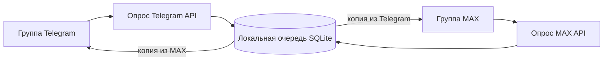

# Как работает текущий мост Telegram ↔ MAX

Согласованное описание сервиса приведено в [README](../../README.md). Ниже описана текущая техническая реализация.

Асинхронное выполнение внедрено: отдельные получатели и отправители работают через `asyncio/aiohttp`, heartbeat не ждёт сетевых ответов. Схема 3 и правила очереди сохраняются. Живой процесс переключён 20.10.2026; расширенная приёмка выполнена частично.

Это локальный прототип для **двух заранее выбранных тестовых групп**. Участники пишут в привычном мессенджере. Бот читает новые сообщения своей группы и публикует копии в другой группе **от имени бота**, добавляя имя исходного автора и название площадки.

Актуализация 20.10.2026: изменения надёжности и async-код внедрены в живое тестовое окружение, пользователь подтвердил работу; дополнительный тест дал 44 доставки. Схема базы — 3; локальный монитор запущен отдельно. Серверного размещения и внешней доставки оповещений пока нет; условия подготовки сервера заказчика описаны в [требованиях к размещению](CUSTOMER-SERVER-REQUIREMENTS.md).

Например, если Анна пишет в Telegram «Когда занятие?», в MAX появляется сообщение от бота:

> Анна · Telegram  
> Когда занятие?

Связь двусторонняя: тот же путь работает из MAX в Telegram. Бот не выдаёт себя за автора; имя участника указано в тексте копии. В первой версии переносятся новые обычные тексты, картинки и подписи к ним. [Исходный код](bridge.py).

## Путь сообщения



1. Программа опрашивает Telegram через `getUpdates`, MAX через `/updates`. В обоих случаях используется получение новых событий по указателю: `update_id` или `marker`. Вебхуки в текущем тесте не используются. Получатели выполняются независимо: каждый делает один запрос за раз и ждёт около секунды после успеха. При сетевой ошибке задержка растёт от 2 до 30 секунд; `retry_after` может увеличить её. Один медленный запрос не задерживает независимые операции другой платформы.
2. Она принимает только новые сообщения из ID двух групп, записанных в `.env`. События из личных чатов и других групп игнорируются. Свои сообщения каждый бот распознаёт по ID и не отправляет обратно — это основная защита от цикла.
3. Из события берутся текст, имя автора, картинка, подпись и сведения об ответе на другое сообщение. Вложения вне объёма теста отмечаются текстом «Вложение вне объёма теста не перенесено».
4. Сообщение разбивается на части, если оно не помещается в ограничения отправки. Каждая часть становится задачей в локальной очереди. Программа отправляет задачи по порядку отдельно для каждого направления и сохраняет ID опубликованной копии.

Сообщение и указатель входящих событий записываются в SQLite **одной транзакцией**. Поэтому после перезапуска ранее принятое событие не должно исчезнуть между подтверждением чтения и записью задачи. Дополнительно таблица `inbox` хранит сочетание «площадка + чат + ID сообщения»: повторно полученное событие не создаёт новую задачу.

## Текст, картинки и ответы

Некорректное содержимое события выбранной группы теперь попадает в отдельный карантин с причиной. Остальные сообщения пакета обрабатываются; карантин и курсор сохраняются в той же транзакции. Открытые проблемы видны через `status`. Чужие чаты не архивируются. При неизвестном чате, ошибке базы или неожиданной ошибке программы пакет не подтверждается. Восстановленное позднее событие может попасть после более новых сообщений.

Для картинки программа скачивает файл, проверяет предел **10 МиБ** и распознаёт JPEG, PNG или WEBP по содержимому. Telegram иногда отдаёт фотографию с общим MIME-типом `application/octet-stream`, поэтому одного заголовка недостаточно. Картинка загружается на целевую площадку заново: локальные ID файлов Telegram и MAX между собой не подходят. Первая картинка получает подпись; дополнительные картинки одного сообщения могут стать отдельными сообщениями. Оформление альбома не сохраняется.

Если участник отвечает на сообщение, программа ищет сохранённое соответствие ID исходного сообщения и его копии. Когда соответствие найдено, отправляет **настоящий ответ** средствами целевой площадки. Если связь недоступна, короткая цитата исходного текста остаётся в теле копии. Живой тест 19.10.2026 подтвердил ответы в обе стороны.

Форматирование исходного сообщения не переносится как HTML или Markdown. Текст автора отправляется как обычный текст. Для длинных сообщений применяется разбиение с учётом ограничения Telegram на символы Unicode; картинки и длинная подпись также могут оказаться в нескольких сообщениях.

## Очередь и сбои

Очередь хранится в `.state/bridge.sqlite3` и переживает остановку программы. Основные состояния задачи:

| Состояние | Значение |
|---|---|
| `pending` | Ожидает отправки или безопасного повтора |
| `sending` | Запрос публикации начался, результат ещё не записан |
| `sent` | API вернул успешный результат, ID копии сохранён |
| `failed` | Обнаружена определённая ошибка; нужна проверка |
| `uncertain` | Неизвестно, успела ли площадка опубликовать сообщение; нужна ручная проверка |
| `skipped` | Оператор явно пропустил задачу с записью причины; доставка следующих задач разрешена |

Для восстановления используются команды `queue retry/confirm/skip` и `quarantine retry`; перед изменением очереди мост нужно остановить. Просмотр доступен во время работы и не выводит содержимое сообщений. Все ручные изменения фиксируются в `audit`. Порядок действий — в [инструкции оператора](OPERATIONS.md).

Ограничение частоты в коде: между отправками в Telegram не менее **3,2 с**, в MAX — **0,6 с**. При ошибке ограничения частоты `429` или `attachment.not.ready` задача остаётся в `pending` и пробуется позже. Если связь оборвалась либо сервер ответил ошибкой после начала публикации, задача переходит в `uncertain`: автоматический повтор мог бы создать дубль. В этом случае **данное направление перестаёт отправлять следующие задачи** до ручного разбора; обратное направление может продолжать работу. При аварийном завершении оставшиеся `sending` после перезапуска переводятся в `uncertain`.

Блокировка `.state/process.lock` не позволяет двум копиям прототипа одновременно читать события одного бота. База также привязана к конкретной паре ботов и чатов, чтобы её случайно не использовать с другой группой.

## Где находятся настройки и как запускать

Настройки лежат в `02-messenger-sync/.env`: токены двух отдельных тестовых ботов, ID групп, ожидаемые имена ботов и при необходимости `MAX_CA_FILE`. Образец полей — в [`.env.example`](../.env.example). Сам `.env` исключён из Git и имеет права доступа `0600`. Файлы состояния находятся в `02-messenger-sync/.state/`; этот каталог тоже исключён из Git.

Из корня `sync-message`, после `uv sync --locked`:

```sh
.venv/bin/python 02-messenger-sync/poc/bridge.py doctor
.venv/bin/python 02-messenger-sync/poc/bridge.py run
.venv/bin/python 02-messenger-sync/poc/bridge.py status
```

`doctor` проверяет токены, ботов, группы, права и отсутствие вебхуков; `run` запускает пересылку; `status` показывает состояние процесса, обоих направлений и очереди. Остановка работающего `run` — **Ctrl+C** в его терминале. Подготовка новых групп описана в [корневом README](../../README.md#локальный-запуск-и-проверки). Компьютер и процесс должны работать, чтобы новые сообщения пересылались; автозапуска и серверного размещения нет.

`run` сохраняет heartbeat, время успешных опросов и доставок. `health --json` даёт машинный снимок и ненулевой код при проблемах. Отдельный `monitor` выдаёт события о сбоях и восстановлении, сохраняя состояние между запусками. События можно писать в локальный JSONL-файл; отправка внешнему получателю пока не подключена. Инструкция и пороги — в [OPERATIONS.md](OPERATIONS.md#мониторинг).

Для HTTPS используется проверка сертификатов. Дополнительный корневой сертификат MAX, если указан, применяется только к запросам MAX. Скачивание медиа MAX разрешено лишь по HTTPS с перечисленных в коде доменов платформы/CDN. В консоль не выводятся токены и содержимое сообщений, но **SQLite хранит тексты, имена, ID и ссылки на картинки** для очереди; автоматической очистки пока нет.

## Границы текущей версии

- Переносятся события после подключения ботов; старый архив не импортируется. История, доступная новому участнику внутри каждого мессенджера, зависит от настроек самого чата.
- Редактирование и удаление сообщений не синхронизируются. Видео, файлы, голосовые, реакции и прочие вложения не передаются как медиа.
- Перенос картинок, текста и ответов в обе стороны проверен на живых тестовых группах; async-проверка дала 44 доставки. Пятиминутный отказ MAX проверен локальным HTTP-стендом; расширенная живая приёмка остаётся частичной. Протоколы этих проверок сохранены в истории Git до коммита `0c378a3`.
- При неоднозначном результате публикации мост предпочитает остановить направление и показать проблему, поэтому гарантии доставки каждого сообщения без дублей при любом сбое пока нет.
- Подключение VK Messenger в этот код не входит; его возможности исследуются отдельно.

Прототип использует Python 3.11+ и `aiohttp==3.14.5`, рассчитан на macOS/Linux. Зависимости закреплены в `pyproject.toml`/`uv.lock`; aiogram/maxapi не подключены. Его текущий объём — испытание с тестовыми данными, а не рабочее хранение переписки учеников.

## Выполнение и остановка async-версии

Один event loop запускает два получателя, два последовательных отправителя и heartbeat каждые 2 секунды. SQLite используется одним потоком; транзакции не содержат сетевых ожиданий. HTTP-сессии сохраняются на весь запуск и закрываются перед освобождением блокировки процесса. Ошибка хранилища или программы останавливает runtime; она не превращается в бесконечный сетевой retry.

При SIGTERM новые операции не начинаются, активным даётся до 30 секунд на завершение. Если публикация отменена без результата, задача становится `uncertain`; если прервана только подготовка фото, она остаётся `pending`. Готовое после запроса остановки фото не начинает новую публикацию. При 401/403 во время опроса платформа приостанавливается до проверки прав и перезапуска; другая продолжает доступные операции. Конфликт poller 409 останавливает мост целиком.
